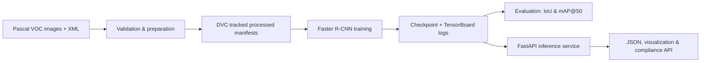

# Industrial Safety Detection

> An end-to-end computer-vision and MLOps project for detecting hard hats, heads, and people in construction imagery.

[](https://www.python.org/)
[](https://pytorch.org/)
[](https://fastapi.tiangolo.com/)
[](https://dvc.org/)
[](https://www.docker.com/)
[](LICENSE)

## Why this project

Construction-site safety is a practical computer-vision problem with real deployment constraints: data quality, reproducibility, hardware differences, inference latency, and an interface that another application can consume. This repository treats the model as one part of a complete system rather than a standalone notebook experiment.

The system trains a **Faster R-CNN ResNet-50-FPN** detector on the public [Hard Hat Workers dataset](https://public.roboflow.ai/object-detection/hard-hat-workers), evaluates it with IoU and mAP@50 metrics, and serves predictions through a FastAPI application.

> **Status:** This is a reproducible baseline. The repository deliberately does not publish unverified training metrics. Run the pipeline with your environment and dataset copy to generate an auditable evaluation report.

## Highlights

- **Real Pascal VOC data pipeline** with XML validation, bounds corrections, deterministic train/validation splitting, and leakage checks.
- **Production-style training loop** with checkpointing, TensorBoard logging, gradient accumulation, and automatic CUDA / Apple Silicon MPS / CPU selection.
- **Reproducible DVC DAG** for data preparation, training, and evaluation.
- **FastAPI inference service** with OpenAPI docs, JSON predictions, annotated-image output, health checks, and a safety-compliance advisory endpoint.
- **Docker and Docker Compose** support for repeatable deployment.
- **Automated tests** covering dataset handling, model components, metrics, inference helpers, and API behavior.

## System overview



## Tech stack

| Area | Tools |
| --- | --- |
| Detection model | PyTorch, Torchvision, Faster R-CNN ResNet-50-FPN |
| Data & reproducibility | Pascal VOC, DVC, YAML configuration |
| Experiment tracking | TensorBoard |
| API | FastAPI, Uvicorn, Pydantic |
| Deployment | Docker, Docker Compose |
| Quality | Pytest, GitHub Actions |

## Repository layout

```text
.
├── api/                         # FastAPI application and inference service
├── configs/config.yaml          # Dataset, model, and training configuration
├── scripts/                     # Environment, data, training, and evaluation CLIs
├── src/object_detection/        # Installable application package
│   ├── data/                    # VOC parsing, validation, preprocessing, dataset
│   ├── evaluation/              # IoU and mAP@50 evaluation
│   ├── inference/               # Visualization and compliance heuristic
│   ├── models/                  # Faster R-CNN model factory
│   └── training/                # Trainer and checkpoint management
├── tests/                       # Automated regression tests
├── dvc.yaml                     # Reproducible pipeline definition
├── Dockerfile                   # Container image definition
└── postman/                     # Ready-to-import API collection
```

## Quick start

### 1. Create an environment

```bash
python3 -m venv .venv
source .venv/bin/activate
python -m pip install --upgrade pip
pip install -r requirements.txt
pip install -e .
python scripts/verify_env.py
```

### 2. Download the dataset

Download the Pascal VOC export from the [Hard Hat Workers dataset page](https://public.roboflow.ai/object-detection/hard-hat-workers), then extract it at:

```text
Hard Hat Workers.v2-raw.voc/
├── train/
├── valid/
└── test/
```

The raw images and generated artifacts are intentionally excluded from Git. The bundled dataset documentation identifies the export as public domain; review the source terms before using it elsewhere.

### 3. Prepare, train, and evaluate

```bash
# Validate the VOC annotations and create reproducible manifests.
python scripts/prepare_real_data.py

# Train the detector (downloads torchvision pretrained weights if needed).
python scripts/train.py

# Write evaluation metrics to artifacts/metrics/evaluation.json.
python scripts/evaluate.py
```

Or run the complete data-to-metrics pipeline through DVC:

```bash
dvc repro
```

### 4. Run the API

```bash
uvicorn api.main:app --host 0.0.0.0 --port 8000
```

Open interactive API documentation at [http://localhost:8000/docs](http://localhost:8000/docs).

```bash
curl -F "file=@path/to/image.jpg" \
  "http://localhost:8000/predict?confidence_threshold=0.5"
```

Endpoints:

| Method | Endpoint | Purpose |
| --- | --- | --- |
| `GET` | `/health` | Service and model readiness |
| `GET` | `/model-info` | Model architecture and classes |
| `POST` | `/predict` | JSON detection results |
| `POST` | `/predict/visualize` | Annotated JPEG response |
| `POST` | `/compliance` | Advisory hard-hat compliance assessment |

The compliance endpoint is an assistive bounding-box heuristic, not a safety certification system. This data export contains no vest annotations, so vest status is not inferred.

## Configuration and reproducibility

All operational settings live in [configs/config.yaml](configs/config.yaml): class mapping, image sizing, device selection, hyperparameters, output paths, and random seed. The DVC pipeline records the dependencies and outputs for preparation, training, and evaluation in [dvc.yaml](dvc.yaml).

Generated data, model checkpoints, experiment logs, and DVC cache are ignored by Git to keep the codebase lightweight. Use an external DVC remote or a release asset to share trained weights with collaborators.

## Testing

```bash
pytest -v
```

## Containerized run

```bash
docker compose up --build
```

## Development notes

Contributions and issue reports are welcome—please read [CONTRIBUTING.md](CONTRIBUTING.md). For security concerns, see [SECURITY.md](SECURITY.md).

## License

Distributed under the [MIT License](LICENSE).

## Acknowledgements

- [Roboflow Universe — Hard Hat Workers](https://public.roboflow.ai/object-detection/hard-hat-workers) for the public dataset export.
- The PyTorch and Torchvision communities for the detection framework.
